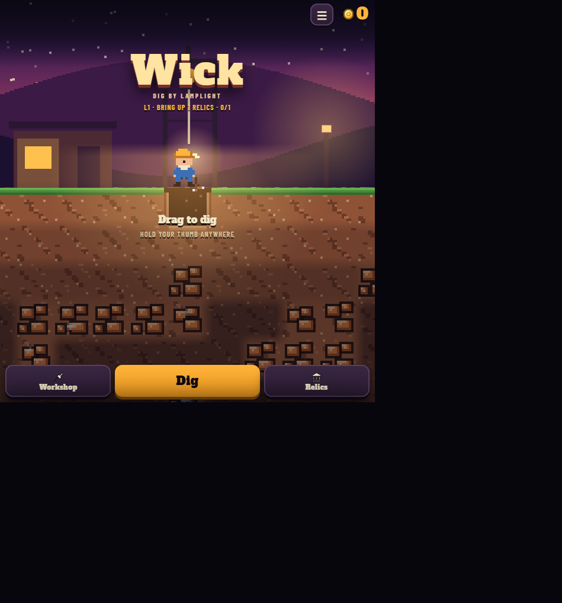
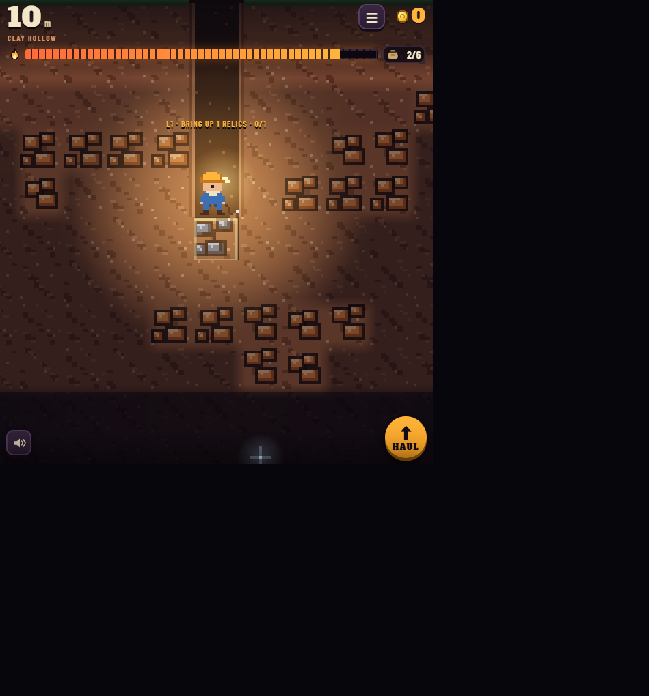

# Wick

**Wick** is a pixel-art mining game about going deeper than your lamp can safely
carry you. Descend through a dark mine, break rock, collect ore and relics, then
haul your discoveries back to the surface before your oil runs out.

## Screenshots

### Surface camp

The surface is your safe starting point. From here you can start a dive, visit
the Workshop, inspect your relic collection, and check the current level goal.



### Inside the mine

The lamp reveals only the area around you. Watch the oil and pack meters while
you search for valuable ore, relics, flasks, and routes through the rock.



## How to play

1. Start at the surface and press **Dig**.
2. Move through the mine using the **Arrow keys** or by **dragging/holding
   anywhere on the game screen**.
3. Break rock to open routes and collect anything valuable that you uncover.
4. Keep an eye on your supplies:
   - **Oil** is both your light source and your time limit.
   - **Pack space** limits how much ore you can carry.
5. Press **Haul** when you have a valuable load, or when the lamp is getting
   low, to return to the surface and sell your haul.
6. Complete the current level objective to unlock the next expedition.

The first-time guide in the game explains the basics as you play. It can be
skipped and reopened through the in-game menu.

## What you can find

- **Ore:** Copper, Iron, Silver, Gold, Amethyst, Ruby, Sapphire, and Voidstone.
  Ore values increase as you reach deeper zones.
- **Relics:** Collect ancient objects and build a permanent collection.
- **Oil flasks:** Refill part of your lamp's oil supply.
- **Camps:** Later zones contain camps where you can sell safely before making
  the full trip back to the surface.
- **The Deep Heart:** The ultimate objective at the bottom of the mine.

## Hazards and tools

- **Lava** burns through oil quickly.
- **Gas pockets** make the lamp burn faster for a short time.
- **Bedrock** cannot be mined directly, so look for another route.
- **Dynamite** clears a 3x3 area during a dive, but blasting near lava is
  dangerous.
- **Torches** mark routes and help you find your way back through explored
  sections.

## Progression

Spend your earnings in the **Workshop** to improve:

- **Pick:** Mine harder rock faster.
- **Oil:** Carry more lamp oil.
- **Pack:** Carry more ore per haul.
- **Glass:** Increase the area illuminated by the lamp.

The game includes multiple mine zones, level objectives, surface contracts for
bonus coins, relic collection, statistics, level selection, and a daily
challenge mode.

## Controls

| Action | Keyboard | Touch / mouse |
| --- | --- | --- |
| Move and dig | Arrow keys | Drag or hold anywhere on the game |
| Return to the surface | `Haul` button | Tap `HAUL` |
| Open menus and upgrades | On-screen buttons | Tap the relevant button |
| Toggle sound | Sound button | Tap the speaker button |

## Run locally

Wick is a single-page browser game. No build step or package installation is
required.

### Option 1: Open the file

Open [`index.html`](./index.html) directly in a modern browser.

### Option 2: Use a local web server

Serving the folder locally is recommended:

```bash
python -m http.server 8000
```

Then open <http://localhost:8000> in your browser.

The game loads React from the unpkg CDN, so an internet connection is needed
when the page is first opened. Progress is saved in the browser's local
storage.

## Project structure

```text
.
├── index.html    # Game UI, rendering, game logic, and controls
├── surface.png   # README screenshot: surface camp
├── mine.png      # README screenshot: mine gameplay
└── README.md     # This guide
```
